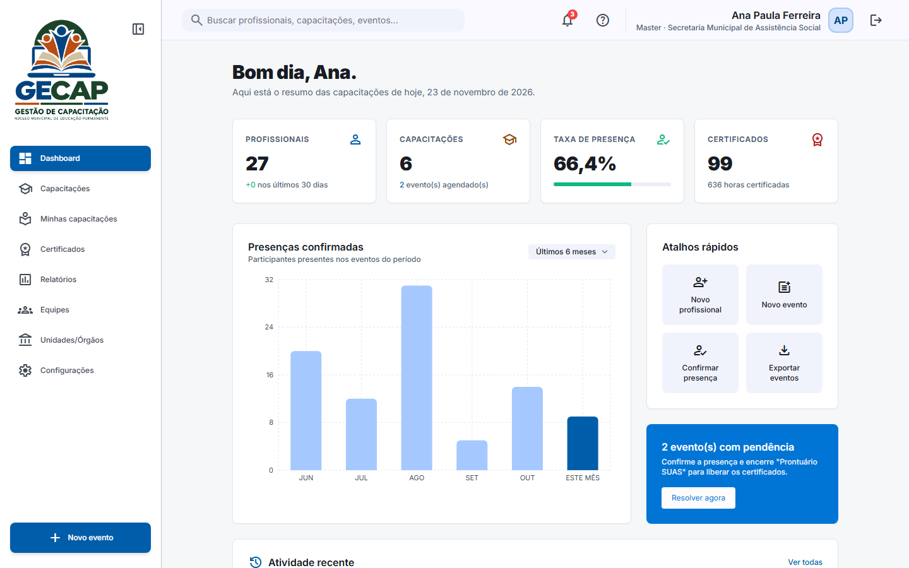
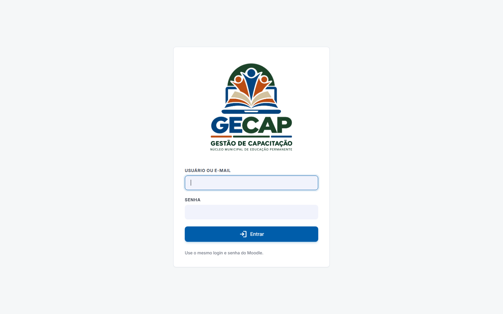
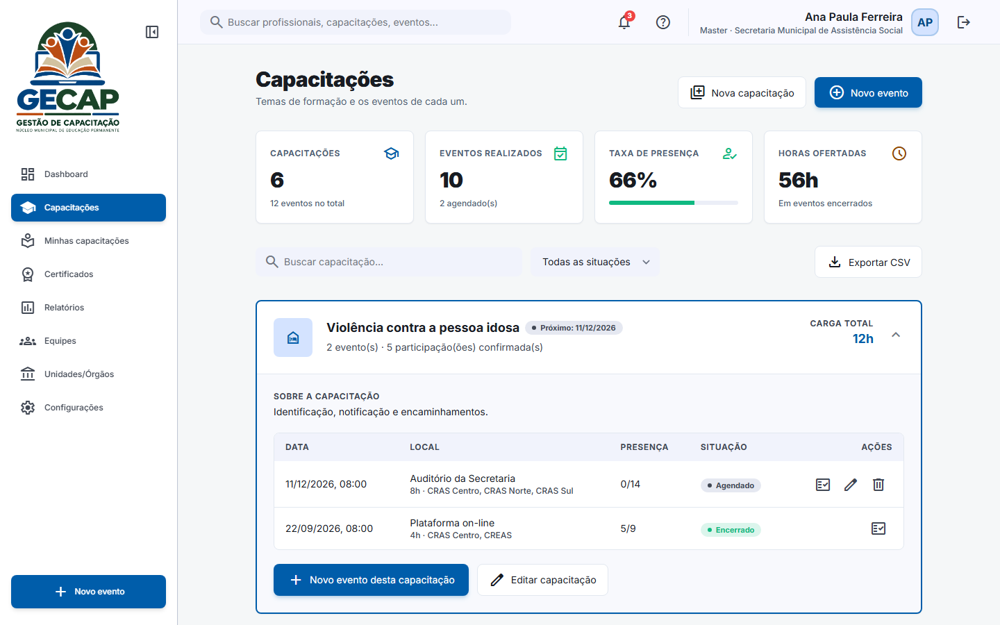
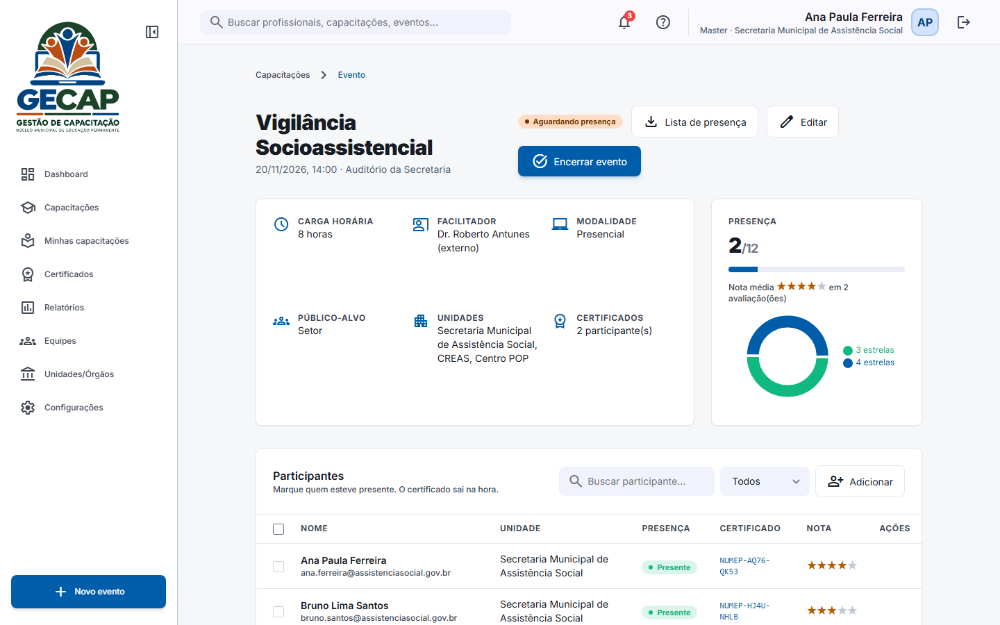
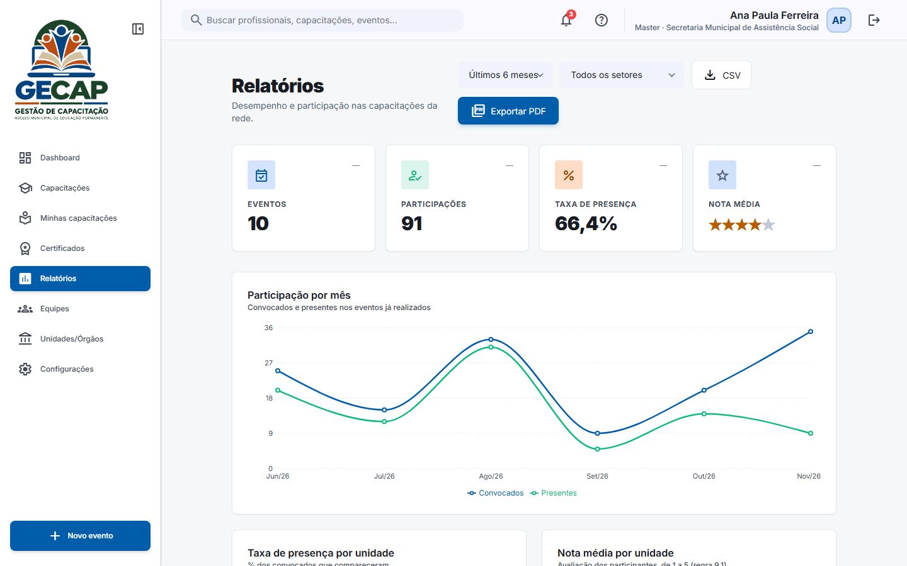
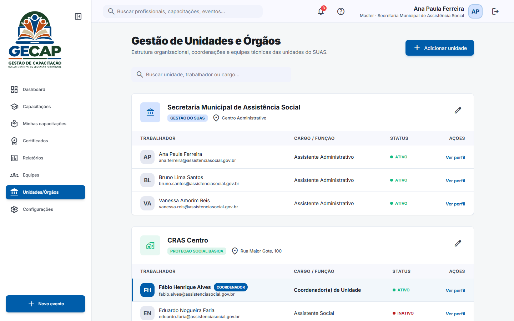
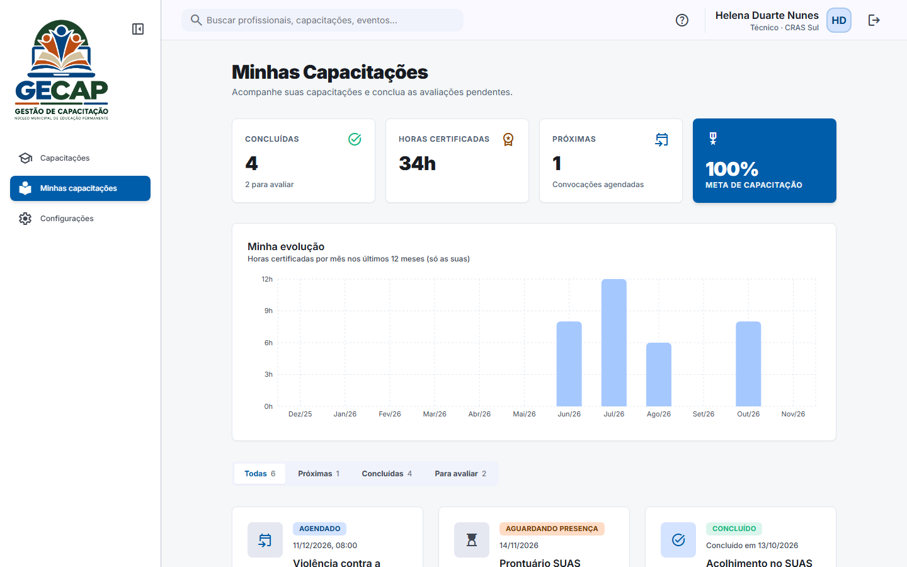
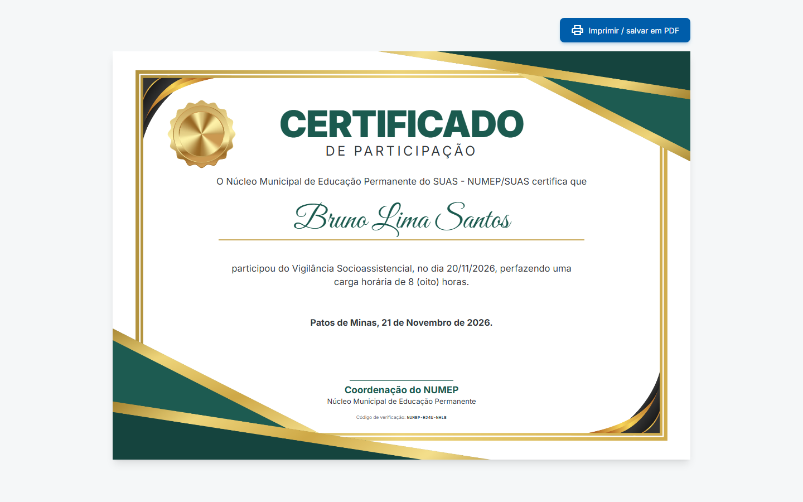
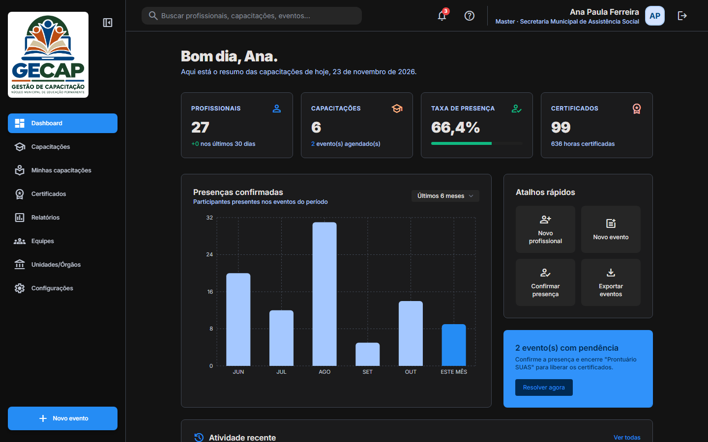
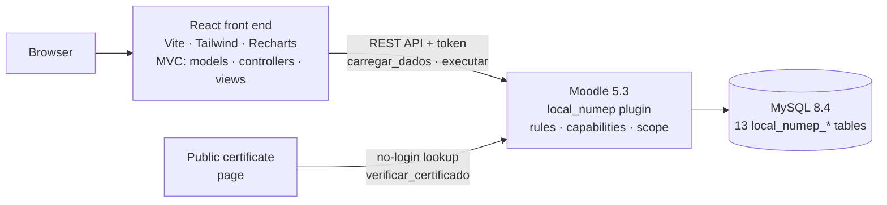

<div align="center">


# GECAP — Training Management

**A web system to manage the training programs of a municipal social assistance network (Brazil's SUAS)**,
built for the Municipal Center for Continuing Education (NUMEP).

[Português](README.md) · **English**


[](https://codespaces.new/Fellipequeiroz/GECAP-Gestao-de-Capacitacoes)

</div>

<p align="center"></p>

> The application itself is in Brazilian Portuguese, as it was built for a Brazilian public agency. The code comments and the detailed docs in `docs/` are in Portuguese as well; this page summarizes the project in English.

---

## About

NUMEP plans and runs training sessions for the social assistance professionals of a city. Invitations, attendance lists, evaluations and certificates used to be handled by hand, in spreadsheets and on paper: slow, error-prone and hard to audit.

**GECAP** brings the whole cycle into one place:

1. **Training and event:** a manager registers the topic and schedules the event (date, place, workload, facilitator and invited units).
2. **Automatic invitations:** active professionals from the selected units are added to the event list.
3. **Attendance and certificate:** confirming attendance **issues the participant's certificate immediately**, with a public verification code; closing the event issues the facilitator's certificate.
4. **Evaluation:** each participant rates the training (1 to 5 stars plus a comment).
5. **Insights:** dashboards and reports show attendance, certified hours and ratings by period, sector and unit.

> Final undergraduate project (TCC) in **Information Systems** — UNIPAM, Brazil, 2026.

## Highlights

- **4 access profiles** (Master, Director, Coordinator and Technician), each with its own screens and its **data scope enforced on the server**: a coordinator only receives data from their own unit, a director from their department, and a technician only their own records.
- **Back end built as a Moodle 5.3 plugin** (`local_numep`): custom tables, business rules, capabilities and a REST API, reusing Moodle's authentication, roles, logging and privacy (GDPR/LGPD) features.
- **React front end organized as MVC** (models, controllers and views), with Tailwind CSS 4, Recharts charts, light/dark theme and a collapsible side menu.
- **Certificates with "frozen" data** (snapshots): editing an event later never changes an issued certificate. Public verification by code, no login required, and a certificate text template the Master can edit with a live preview.
- **Security applied and verified:** SHA-512 crypt password hashing, parameterized queries, a capability check on every action, account lockout after failed logins, token revocation on logout, a Content Security Policy in the production build and CSV-injection protection.
- **Complete GitHub Codespaces environment:** a Dev Container sets up Moodle, MySQL, the plugin and demo data.

## Screens

| | |
| :---: | :---: |
|  **Login** with a Moodle account |  **Trainings** and their events |
|  **Event**: attendance, certificates and ratings |  **Reports** with filters and period comparison |
|  **Units** and their teams |  **My trainings** (technician view) |
|  **Certificate** ready to print or save as PDF |  **Dark theme** |

The prototypes the screens started from (Google Stitch) are in [`docs/prototipos`](docs/prototipos).

## Access profiles

| Feature | Master | Director | Coordinator | Technician |
| --- | :---: | :---: | :---: | :---: |
| Dashboard and reports | ✔ whole network | ✔ own department | ✔ own unit | |
| Create and edit trainings and events | ✔ | ✔ | | |
| Confirm attendance (issues the certificate) | ✔ | ✔ own department | ✔ own unit | |
| Units and teams | ✔ edit | ✔ view | ✔ view | |
| My trainings, evaluation and profile | ✔ | ✔ | ✔ | ✔ |
| Manage professionals, units and job titles | ✔ | | | |
| Certificates and certificate template | ✔ | | | |

The front end only shows what each profile can use, but **the server has the final word**: every action goes through Moodle's `require_capability`, and direct API calls outside the profile are rejected.

## Architecture



- **Why Moodle as the back end?** It already handles authentication, roles and capabilities, auditing, password policies and privacy requests (export and delete a person's data). The plugin only adds the domain: tables, rules and API.
- **One read, many screens:** `carregar_dados` returns, in a single call, the data within the user's scope; the front end computes indicators, filters and charts in memory. Writes go through `executar`, which maps each action to the capability it requires.
- **Rules on both sides:** the front end validates for fast feedback; the plugin validates again before writing, inside database transactions.

## Tech stack

| Layer | Technologies |
| --- | --- |
| Front end | React 18, React Router 7, Vite 8, Tailwind CSS 4, Recharts 3 |
| Back end | Moodle 5.3 (PHP 8.3), local plugin with a web services (REST) API |
| Database | MySQL 8.4 (Moodle XMLDB; also compatible with PostgreSQL) |
| Environment | GitHub Codespaces / Dev Containers (Docker Compose) |

## Getting started

### Option 1 — GitHub Codespaces (recommended)

1. Click **[Open in GitHub Codespaces](https://codespaces.new/Fellipequeiroz/GECAP-Gestao-de-Capacitacoes)**.
2. On first start the container downloads and installs Moodle 5.3, the plugin and demo data (a few minutes; follow the *Creation log*).
3. Open port **5173** (*Ports* tab) and sign in with one of the [demo accounts](#demo-accounts).
   If you get **502 Bad Gateway**, see [troubleshooting](#troubleshooting-codespaces).

### Option 2 — Local

Requirements: **PHP 8.3+** (Moodle extensions: intl, gd, zip, mysqli, soap, exif), **MySQL 8.4+**, **Composer** and **Node.js 20.19+**.

```bash
# 1. Moodle 5.3, next to this repository
git clone --depth 1 -b MOODLE_503_STABLE https://github.com/moodle/moodle.git ../moodle
cd ../moodle && composer install --no-dev

# 2. GECAP plugin
cp -r ../GECAP-Gestao-de-Capacitacoes/numep public/local/numep

# 3. Install Moodle (adjust the data path and passwords)
php admin/cli/install.php --non-interactive --agree-license --lang=pt_br \
  --wwwroot=http://localhost:8080 --dataroot=/absolute/path/to/moodledata \
  --dbtype=mysqli --dbhost=127.0.0.1 --dbname=moodle --dbuser=moodle --dbpass=YOUR_PASSWORD \
  --fullname=GECAP --shortname=GECAP --adminuser=admin --adminpass=YOUR_ADMIN_PASSWORD \
  --adminemail=admin@example.local

# 4. Enable the API and load the demo data
php public/local/numep/cli/configurar_api.php
php public/local/numep/cli/dados_exemplo.php --confirmar

# 5. Moodle server
php -S localhost:8080 -t public
```

In another terminal, from this repository:

```bash
cd front
npm install
npm run dev   # http://localhost:5173 (Vite proxies /moodle to Moodle on :8080)
```

### Demo accounts

All use the password **`Numep@2026`** (fictional data, for demonstration only):

| Profile | Username |
| --- | --- |
| Master | `ana.ferreira@assistenciasocial.gov.br` |
| Director | `bruno.santos@assistenciasocial.gov.br` |
| Coordinator (CRAS Sul) | `carla.rocha@assistenciasocial.gov.br` |
| Technician | `helena.nunes@assistenciasocial.gov.br` |

### Troubleshooting (Codespaces)

Run the commands in the Codespace terminal, from the project folder (`/workspaces/GECAP-Gestao-de-Capacitacoes`).

<details>
<summary><b>Port 5173 (or 8080) shows "502 Bad Gateway"</b></summary>

Moodle or the front end is not running. Start both (safe to run more than once):

```bash
bash .devcontainer/iniciar.sh
```

Wait a few seconds and reload the page. This can happen when reopening a Codespace that was stopped.
</details>

<details>
<summary><b>Setup looks stuck on "Running postCreateCommand..."</b></summary>

That is expected on first start: the Codespace downloads and installs Moodle, which takes 5 to 15 minutes. Follow it in <kbd>Ctrl</kbd>+<kbd>Shift</kbd>+<kbd>P</kbd> → **Codespaces: View Creation Log** and don't close that terminal. If setup is interrupted, resume it with:

```bash
bash .devcontainer/instalar-moodle.sh && bash .devcontainer/iniciar.sh
```
</details>

<details>
<summary><b>"php: command not found" in the terminal</b></summary>

The container failed to build and the Codespace opened in **recovery mode** (a minimal environment without PHP). Check the reason in the **Creation log** (search for `ERROR`) and rebuild with <kbd>Ctrl</kbd>+<kbd>Shift</kbd>+<kbd>P</kbd> → **Codespaces: Full Rebuild Container**.
</details>

<details>
<summary><b>See the error logs</b></summary>

```bash
tail -n 40 /tmp/moodle.log /tmp/front.log
```
</details>

<details>
<summary><b>Other useful commands</b></summary>

```bash
bash .devcontainer/sincronizar-plugin.sh                                      # apply changes made in numep/
php /workspaces/moodle/public/local/numep/cli/dados_exemplo.php --confirmar   # reset to the demo data
```

Moodle's admin pages don't open through the Codespace URL (Moodle is configured as `localhost:8080`); the front end works normally because it talks to Moodle inside the container.
</details>

## Repository layout

```
├── front/          React front end (MVC): models, controllers and views
├── numep/          Moodle plugin (local_numep): database, rules, API and tests
├── .devcontainer/  Full environment for GitHub Codespaces
└── docs/           Documentation (Portuguese), screenshots and prototypes
```

## Documentation (in Portuguese)

| Document | Contents |
| --- | --- |
| [Front end](docs/front-end.md) | MVC architecture, screens, API integration and profiles |
| [Moodle plugin](numep/README.md) | Installation, files, API and ER-to-Moodle mapping |
| [Business rules](docs/regras-de-negocio.md) | Domain rules and where each one is enforced |
| [ER model](docs/modelo-er.md) | Entity-relationship diagram and the role of each entity |
| [Security](docs/seguranca.md) | Measures in place, deployment checklist and HTTPS |

## Roadmap

- Generate the certificate PDF on the server and email it to the participant.
- Two-factor authentication with Moodle's `tool_mfa`.
- Anonymous evaluations and per-IP rate limiting on public routes.

## Author

**Fellipe Queiroz Moreira** — Information Systems, UNIPAM, Brazil (2026)
[github.com/Fellipequeiroz](https://github.com/Fellipequeiroz)

## License

Released under the [MIT](LICENSE) license.
