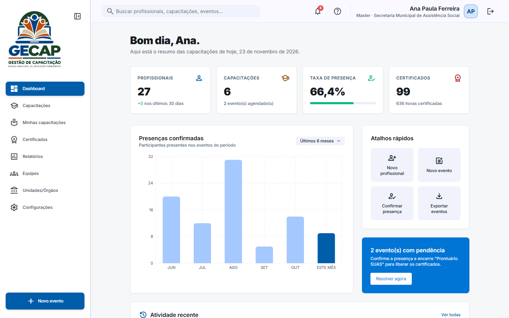
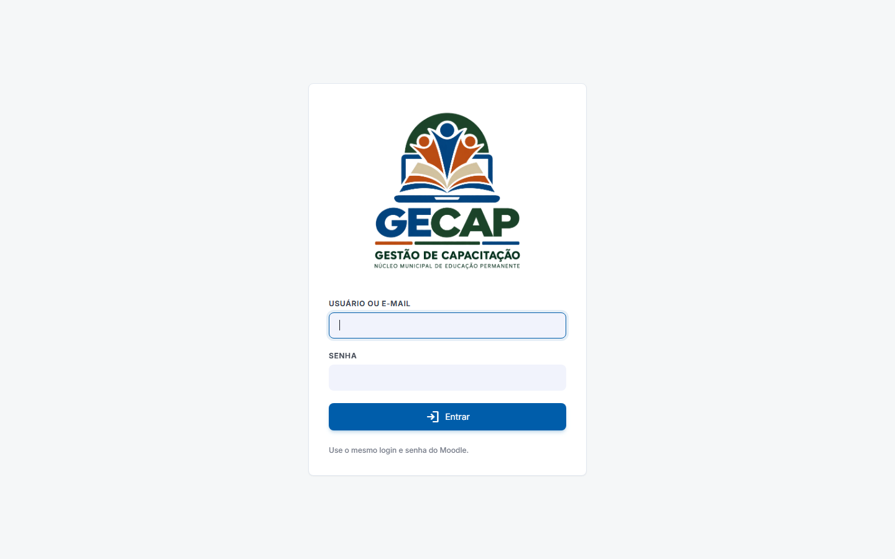
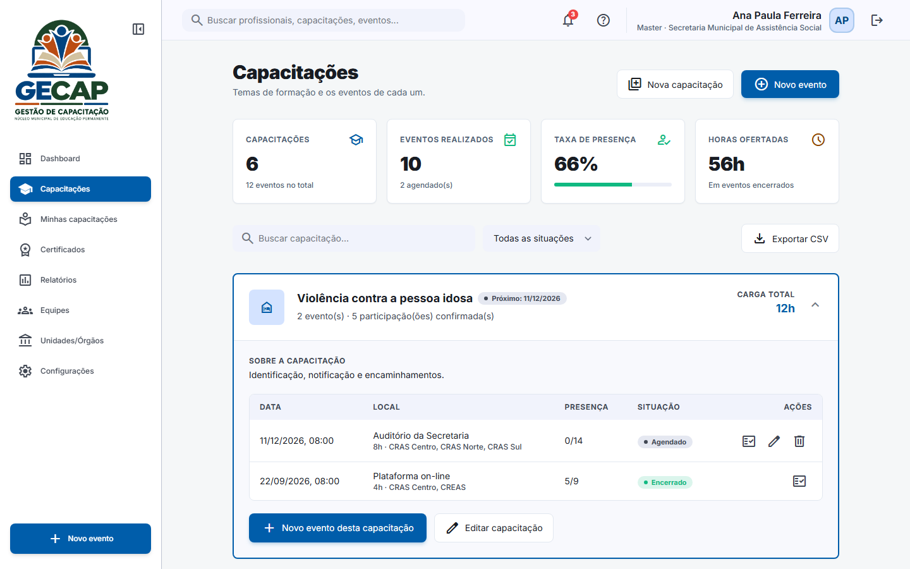
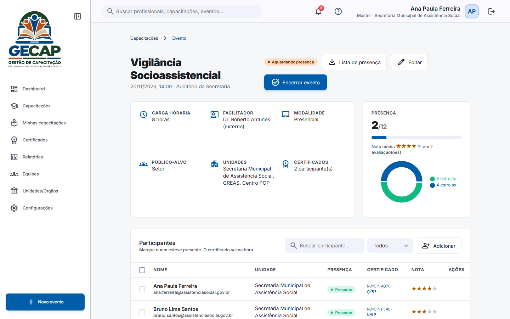
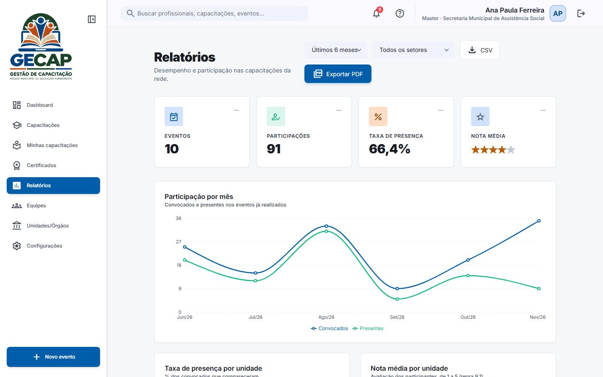
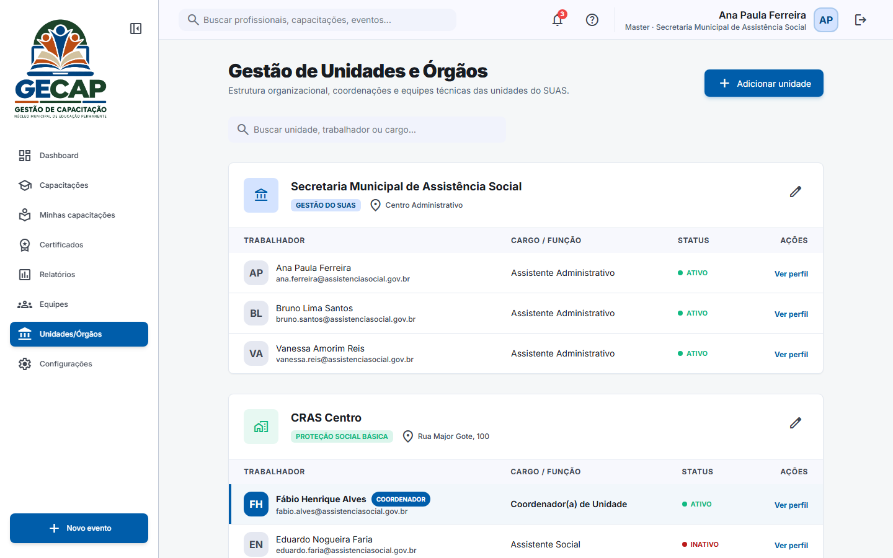
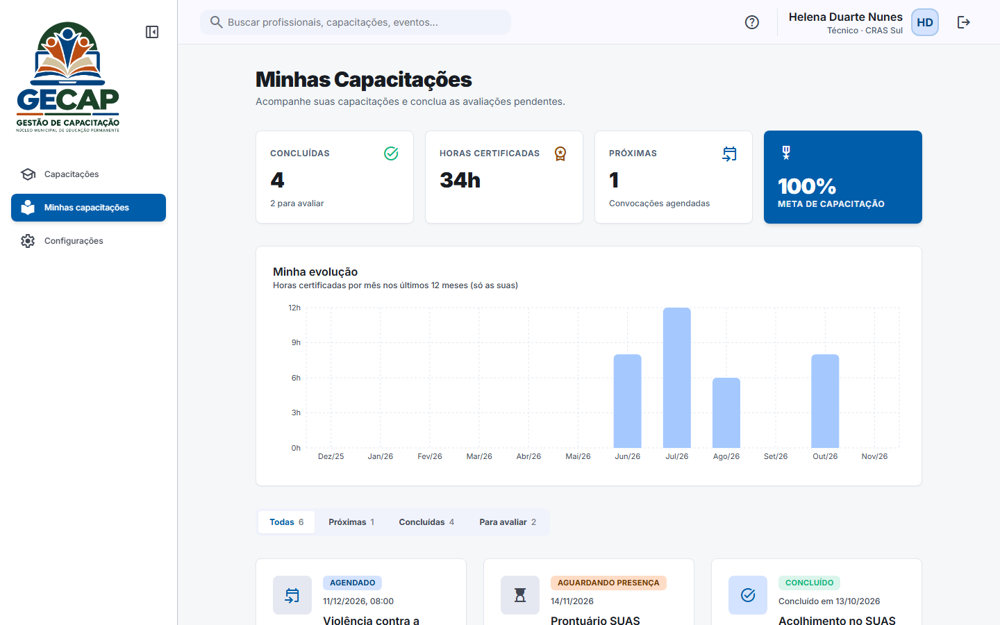
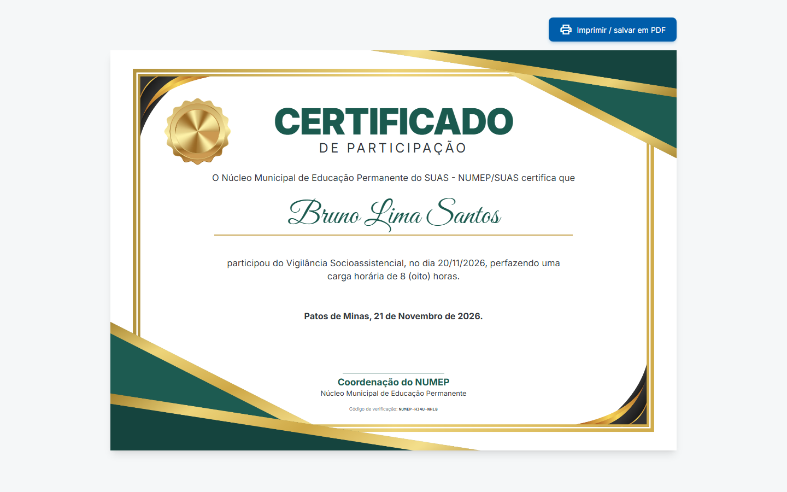
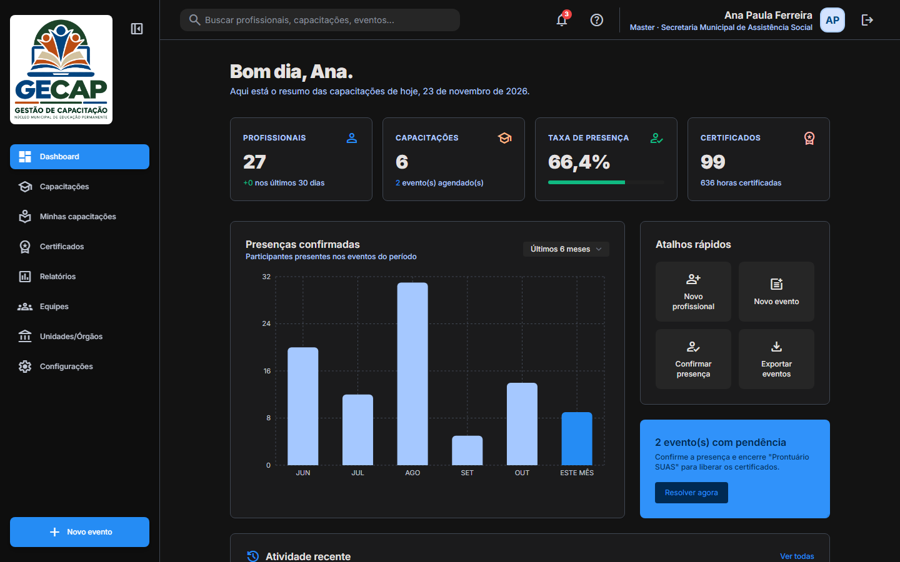
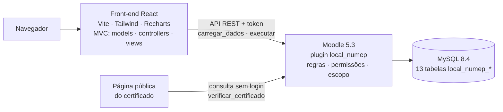

<div align="center">


# GECAP — Gestão de Capacitações

**Sistema web para gestão das capacitações da rede socioassistencial (SUAS)**
do Núcleo Municipal de Educação Permanente (NUMEP).

**Português** · [English](README.en.md)


[](https://codespaces.new/Fellipequeiroz/GECAP-Gestao-de-Capacitacoes)

</div>

<p align="center"></p>

---

## Sobre o projeto

O NUMEP planeja e executa as capacitações dos profissionais da assistência social de um município. Antes, convocações, listas de presença, avaliações e certificados eram controlados à mão, em planilhas e papel: um processo lento, sujeito a erro e difícil de auditar.

O **GECAP** centraliza esse ciclo:

1. **Capacitação e evento:** o gestor cadastra o tema e marca o evento (data, local, carga horária, facilitador e unidades convidadas).
2. **Convocação automática:** os profissionais ativos das unidades escolhidas entram na lista do evento.
3. **Presença e certificado:** ao confirmar a presença, o certificado do participante é **emitido na hora**, com código de verificação público; ao encerrar o evento, sai o certificado do facilitador.
4. **Avaliação:** cada participante avalia a capacitação (1 a 5 estrelas e comentário).
5. **Indicadores:** painéis e relatórios mostram presença, horas certificadas e notas por período, setor e unidade.

> Projeto de conclusão de curso (TCC) em **Sistemas de Informação** — UNIPAM, 2026.

## Destaques

- **4 perfis de acesso** (Master, Diretor, Coordenador e Técnico), cada um com as suas telas e o seu **recorte de dados feito no servidor**: o coordenador só recebe dados da própria unidade, o diretor os da sua diretoria e o técnico apenas os seus.
- **Back-end como plugin do Moodle 5.3** (`local_numep`): tabelas próprias, regras de negócio, permissões e uma API REST, aproveitando autenticação, papéis, logs e LGPD do Moodle.
- **Front-end React em MVC** (models, controllers e views), com Tailwind CSS 4, gráficos Recharts, tema claro/escuro e menu lateral retrátil.
- **Certificados com dados "congelados"** (snapshot): editar o evento depois não altera um certificado já emitido. Verificação pública pelo código, sem login, e modelo de texto editável pelo Master com prévia ao vivo.
- **Segurança aplicada e conferida:** hash SHA-512 crypt das senhas, consultas parametrizadas, permissão checada em cada ação, bloqueio após senhas erradas, revogação do token no logout, CSP no build e proteção contra CSV injection.
- **Ambiente completo no GitHub Codespaces:** um Dev Container monta Moodle, MySQL, o plugin e os dados de demonstração.

## Telas

| | |
| :---: | :---: |
|  **Login** com usuário do Moodle |  **Capacitações** e seus eventos |
|  **Evento**: presença, certificados e avaliações |  **Relatórios** com filtros e comparação de período |
|  **Unidades e órgãos** com as equipes |  **Minhas Capacitações** (visão do técnico) |
|  **Certificado** pronto para imprimir/PDF |  **Tema escuro** |

Os protótipos que deram origem às telas (Google Stitch) estão em [`docs/prototipos`](docs/prototipos).

## Perfis de acesso

| Funcionalidade | Master | Diretor | Coordenador | Técnico |
| --- | :---: | :---: | :---: | :---: |
| Dashboard e relatórios | ✔ rede toda | ✔ sua diretoria | ✔ sua unidade | |
| Criar e editar capacitações e eventos | ✔ | ✔ | | |
| Confirmar presença (emite o certificado) | ✔ | ✔ sua diretoria | ✔ sua unidade | |
| Unidades e equipes | ✔ edita | ✔ consulta | ✔ consulta | |
| Minhas capacitações, avaliação e perfil | ✔ | ✔ | ✔ | ✔ |
| Cadastro de profissionais, unidades e cargos | ✔ | | | |
| Certificados e modelo do certificado | ✔ | | | |

O front mostra apenas o que o perfil pode usar, mas **quem decide é o servidor**: toda ação passa por `require_capability` no Moodle, e chamadas diretas à API fora do perfil são recusadas.

## Arquitetura



- **Por que o Moodle como back-end?** Ele já resolve autenticação, papéis e permissões, auditoria, políticas de senha e LGPD (exportar e apagar dados do titular). O plugin acrescenta só o que é do domínio: tabelas, regras e API.
- **Uma leitura, muitas telas:** `carregar_dados` entrega numa só chamada os dados do escopo do usuário; o front calcula indicadores, filtros e gráficos em memória. As gravações passam por `executar`, que tem uma tabela com a permissão exigida por cada ação.
- **Regras nos dois lados:** o front valida para dar resposta rápida ao usuário; o plugin valida de novo antes de gravar, dentro de transações.

Mais detalhes em [`docs/front-end.md`](docs/front-end.md) e [`numep/README.md`](numep/README.md).

## Tecnologias

| Camada | Tecnologias |
| --- | --- |
| Front-end | React 18, React Router 7, Vite 8, Tailwind CSS 4, Recharts 3 |
| Back-end | Moodle 5.3 (PHP 8.3), plugin local com API de serviços web (REST) |
| Banco de dados | MySQL 8.4 (XMLDB do Moodle; também compatível com PostgreSQL) |
| Ambiente | GitHub Codespaces / Dev Containers (Docker Compose) |

## Como executar

### Opção 1 — GitHub Codespaces (recomendado)

1. Clique em **[Abrir no GitHub Codespaces](https://codespaces.new/Fellipequeiroz/GECAP-Gestao-de-Capacitacoes)**.
2. Na primeira vez, o contêiner baixa e instala o Moodle 5.3, o plugin e os dados de demonstração (alguns minutos; acompanhe pelo *Creation log*).
3. Abra a porta **5173** (aba *Portas*) e entre com um dos [usuários de demonstração](#usuários-de-demonstração).

### Opção 2 — Local

Requisitos: **PHP 8.3+** (extensões do Moodle: intl, gd, zip, mysqli, soap, exif), **MySQL 8.4+**, **Composer** e **Node.js 20.19+**.

```bash
# 1. Moodle 5.3, ao lado deste repositório
git clone --depth 1 -b MOODLE_503_STABLE https://github.com/moodle/moodle.git ../moodle
cd ../moodle && composer install --no-dev

# 2. Plugin do GECAP
cp -r ../GECAP-Gestao-de-Capacitacoes/numep public/local/numep

# 3. Instalar o Moodle (ajuste o caminho dos dados e as senhas)
php admin/cli/install.php --non-interactive --agree-license --lang=pt_br \
  --wwwroot=http://localhost:8080 --dataroot=/caminho/absoluto/moodledata \
  --dbtype=mysqli --dbhost=127.0.0.1 --dbname=moodle --dbuser=moodle --dbpass=SUA_SENHA \
  --fullname=GECAP --shortname=GECAP --adminuser=admin --adminpass=SUA_SENHA_ADMIN \
  --adminemail=admin@exemplo.local

# 4. Ligar a API e gravar os dados de demonstração
php public/local/numep/cli/configurar_api.php
php public/local/numep/cli/dados_exemplo.php --confirmar

# 5. Servidor do Moodle
php -S localhost:8080 -t public
```

Em outro terminal, na pasta deste repositório:

```bash
cd front
npm install
npm run dev   # http://localhost:5173 (o Vite repassa /moodle para o Moodle em :8080)
```

### Usuários de demonstração

Todos com a senha **`Numep@2026`** (dados fictícios, só para demonstração):

| Perfil | Usuário |
| --- | --- |
| Master | `ana.ferreira@assistenciasocial.gov.br` |
| Diretor | `bruno.santos@assistenciasocial.gov.br` |
| Coordenadora (CRAS Sul) | `carla.rocha@assistenciasocial.gov.br` |
| Técnica | `helena.nunes@assistenciasocial.gov.br` |

## Estrutura do repositório

```
├── front/          Front-end React (MVC): models, controllers e views
├── numep/          Plugin do Moodle (local_numep): banco, regras, API e testes
├── .devcontainer/  Ambiente completo para GitHub Codespaces
└── docs/           Documentação, capturas de tela e protótipos
```

## Documentação

| Documento | Conteúdo |
| --- | --- |
| [Front-end](docs/front-end.md) | Arquitetura MVC, telas, integração com a API e perfis |
| [Plugin do Moodle](numep/README.md) | Instalação, arquivos, API e mapeamento do modelo ER para o Moodle |
| [Regras de negócio](docs/regras-de-negocio.md) | As regras do domínio e onde cada uma é garantida |
| [Modelo ER](docs/modelo-er.md) | Diagrama entidade-relacionamento e papel de cada entidade |
| [Segurança](docs/seguranca.md) | Medidas aplicadas, checklist de publicação e HTTPS |

## Próximos passos

- Gerar o PDF do certificado no servidor e enviá-lo por e-mail ao participante.
- Verificação em duas etapas com o `tool_mfa` do Moodle.
- Avaliações anônimas e limite de requisições por IP nas rotas públicas.

## Autor

**Fellipe Queiroz Moreira** — Sistemas de Informação, UNIPAM (2026)
[github.com/Fellipequeiroz](https://github.com/Fellipequeiroz)

## Licença

Distribuído sob a licença [MIT](LICENSE).
