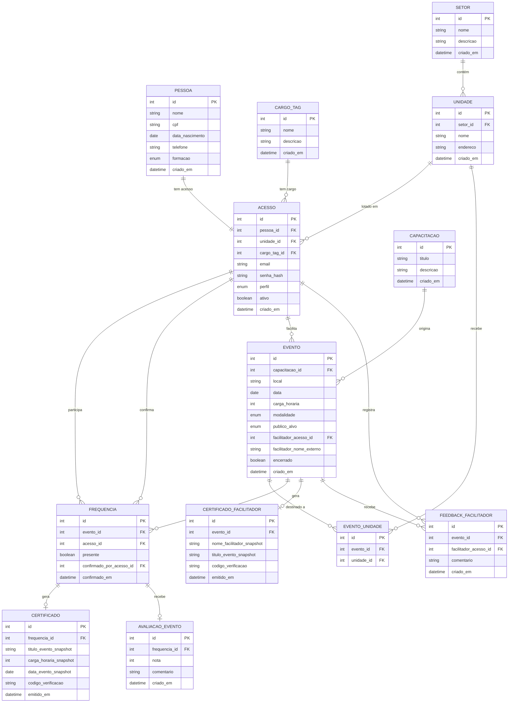

# Modelo entidade-relacionamento

Modelo conceitual do GECAP, com o módulo de pessoas e hierarquia e o módulo de capacitações e eventos. A implementação no Moodle (nomes das tabelas e adaptações) está em [`numep/README.md`](../numep/README.md#4-do-modelo-er-para-o-moodle).

> O GitHub desenha o diagrama abaixo automaticamente (Mermaid).

---

## Resumo das entidades

| Entidade | Papel |
|---|---|
| `PESSOA` | Dados pessoais (CPF, nome, nascimento, formação) — independente de acesso ao sistema |
| `ACESSO` | Credenciais e permissão (email, senha, perfil hierárquico) — vinculada 1:1 a `PESSOA` |
| `CARGO_TAG` | Tag de profissão/cargo, gerenciada pelo Master |
| `SETOR` / `UNIDADE` | Estrutura organizacional da rede |
| `CAPACITACAO` | Tema/assunto de uma formação |
| `EVENTO` | Ocorrência específica de uma capacitação (data, local, facilitador) |
| `EVENTO_UNIDADE` | Tabela associativa — define quais unidades recebem o evento (seleção manual) |
| `FREQUENCIA` | Registro de presença de um `ACESSO` em um `EVENTO` |
| `CERTIFICADO` | Certificado do participante, gerado a partir da frequência confirmada |
| `CERTIFICADO_FACILITADOR` | Certificado do facilitador, gerado no encerramento do evento |
| `AVALIACAO_EVENTO` | Avaliação do evento pelo participante, vinculada à frequência |
| `FEEDBACK_FACILITADOR` | Feedback do facilitador sobre o evento, não anônimo |

## Relacionamentos com múltiplos papéis (`ACESSO`)

A entidade `ACESSO` participa do módulo de capacitação em três papéis distintos, cada um com sua própria FK:

- **Participante** — `FREQUENCIA.acesso_id`
- **Quem confirma presença** — `FREQUENCIA.confirmado_por_acesso_id`
- **Facilitador interno** — `EVENTO.facilitador_acesso_id`

São três relacionamentos independentes com a mesma tabela de destino — não é redundância de modelagem.

---

*As regras que não aparecem no diagrama (unicidade, facilitador interno ou externo, snapshot do certificado etc.) estão em [`regras-de-negocio.md`](regras-de-negocio.md).*
